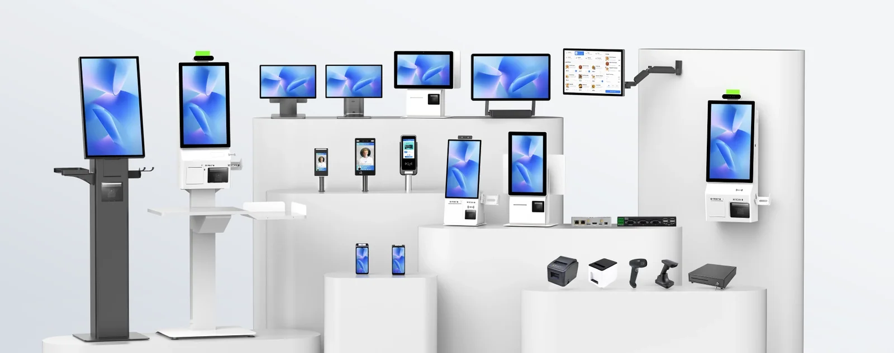
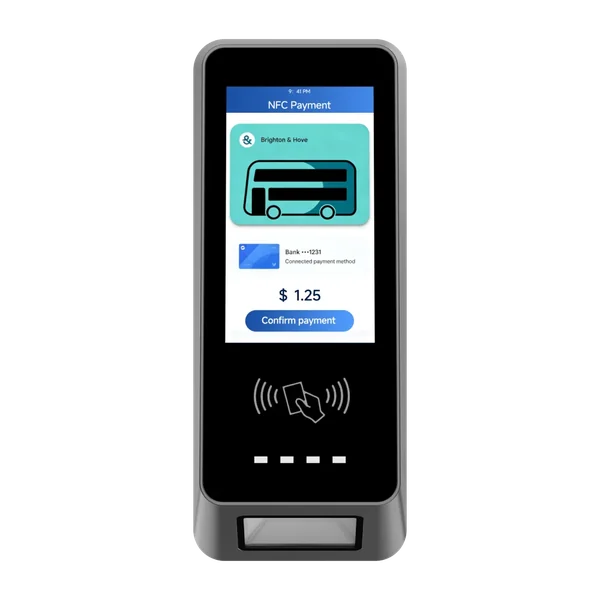
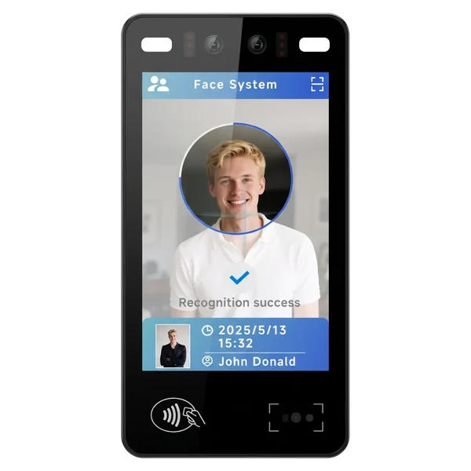
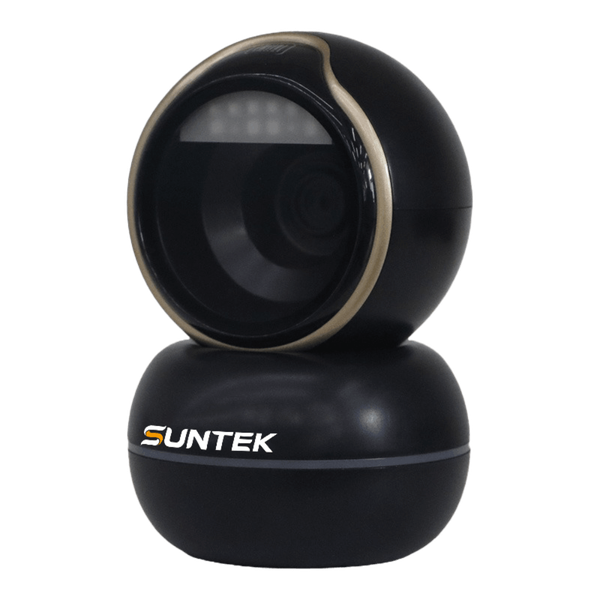
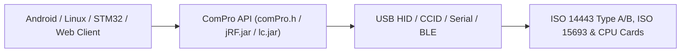

<div align="center">
  <a href="https://www.suntekai.com">
    <picture>
      <source media="(prefers-color-scheme: dark)" srcset="./assets/logo-dark.png">
      <source media="(prefers-color-scheme: light)" srcset="./assets/logo-light.png">
      
    </picture>
  </a>

  <h1>SUNTEK Cross-Platform NFC Card Reader SDK</h1>

  <p>
    <strong>Official Hardware SDK &amp; Developer Kit</strong> &middot; <em>Enjoy Smarter Service</em><br>
    Unified multi-platform SDK supporting Android, Linux C/Java, MCU C, and WebSocket/Browser readers across <strong>SUNTEK</strong> NFC card reader modules (<strong>SUNTEK Technology Co., Ltd.</strong>).
  </p>

  <p>
    <a href="./LICENSE"></a>
    <a href="https://github.com/SUNTEK-Official/suntek-sdk-nfc/releases"></a>
    
    <a href="https://www.suntekai.com/products/"></a>
    <a href="mailto:support@suntekai.com"></a>
  </p>

  <p>
    <a href="#hardware-showcase--compatibility">Hardware</a> &nbsp;&bull;&nbsp;
    <a href="#architecture--key-capabilities">Architecture</a> &nbsp;&bull;&nbsp;
    <a href="#supported-interfaces--physical-connections">Interfaces</a> &nbsp;&bull;&nbsp;
    <a href="#5-minute-quick-start">Quick Start</a> &nbsp;&bull;&nbsp;
    <a href="#sample-apps--prebuilt-downloads">Downloads</a> &nbsp;&bull;&nbsp;
    <a href="#troubleshooting--faq">FAQ</a> &nbsp;&bull;&nbsp;
    <a href="#documentation-changelog--support">Support</a>
  </p>
  
</div>

---

## Hardware Showcase & Compatibility

<table>
  <tr>
    <td align="center" width="33%">
      <a href="https://www.suntekai.com/products/ticket-validator-st5/">
        
      </a>
      <br>
      <strong>ST5</strong><br>
      <sub>Integrated Validator NFC</sub><br>
      <a href="https://www.suntekai.com/products/ticket-validator-st5/">Official Product Page</a>
    </td>
    <td align="center" width="33%">
      <a href="https://www.suntekai.com/products/suntek-facial-recognition-biometric-machine-fa8/">
        
      </a>
      <br>
      <strong>FA8</strong><br>
      <sub>Access Terminal NFC Reader</sub><br>
      <a href="https://www.suntekai.com/products/suntek-facial-recognition-biometric-machine-fa8/">Official Product Page</a>
    </td>
    <td align="center" width="33%">
      <a href="https://www.suntekai.com/products/barcode-reader-r10/">
        
      </a>
      <br>
      <strong>R10</strong><br>
      <sub>Smart Card & QR Reader</sub><br>
      <a href="https://www.suntekai.com/products/barcode-reader-r10/">Official Product Page</a>
    </td>
  </tr>
</table>

| Product Model | Chipset / Board | OS Versions | Build Identifier | Status |
| :--- | :--- | :--- | :--- | :---: |
| **SUNTEK NFC Modules** | USB HID / CCID / Serial / BLE | Android, Linux, Windows, MCU, Web | API V1.21 | Supported |

> [!IMPORTANT]
> Verify your device **Model** and **Build Number** under Android **Settings -> About device** before integration. Customer applications use your own Google Play or enterprise release certificate.

---

## Architecture & Key Capabilities

- **4 Target Environments**: Native Android (`jRF.jar` / `lc.jar`), Linux C/Java (`Makefile`), STM32 MCU C, and WebSocket Browser demos.
- **Broad Card Standard Support**: ISO 14443 Type A/B, MIFARE Classic / Ultralight / DESFire, FM1208 CPU cards, ISO 15693, and SAM slots.
- **Comprehensive Documentation**: Complete English API Reference V1.21 and Web Functions manuals in `docs/` & `web/`.



---

## Supported Interfaces & Physical Connections

| Hardware Feature | Interface Type | Device Path / Service Target | Notes |
| :--- | :--- | :--- | :--- |
| **Android Sample** | USB Host / BLE (`com.example.comprodemov12_as`) | `android/ & sdk/java/` | Includes `jRF.jar` & `lc.jar` |
| **Linux & C Headers** | C/JNI + GCC Makefile + `libcomPro.a` | `include/ & linux/` | Static archives included for x64, x86, ARM & LoongArch |
| **MCU & Web Readers** | STM32 C / Web Browser Demo | `mcu/ & web/` | Web integration demo & API manual |

---

## Repository Directory Layout

```text
suntek-sdk-nfc/
├── assets/                 # Official SUNTEK logos, banners & hardware photos
├── sdk/
│   └── java/               # jRF.jar & lc.jar standalone Java libraries
├── include/                # C/C++ NFC reader headers (comPro.h, FM1208.h)
├── android/                # Android Studio sample project (jRF.jar & lc.jar bundled)
├── linux/                  # Linux C/Java samples, Makefiles & libcomPro.a archives
├── mcu/                    # STM32 MCU reference sample
├── web/                    # Browser demo + Web-Functions.pdf
├── docs/                   # English SDK API V1.21, Demo Guide & Android Dev Guide
├── README.md
├── LICENSE
├── THIRD_PARTY_NOTICES.md
└── CHANGELOG.md
```

> All installers (`.exe`), compiled sample APKs (`.apk`), and large binary packages (> 5 MB) are hosted on [**GitHub Releases**](https://github.com/SUNTEK-Official/suntek-sdk-nfc/releases) with `SHA256SUMS.txt`.

---

## Prerequisites & Permissions

- **Platform Target**: `minSdk 16` / `targetSdk 30`
- **App Signing Requirement**: No special platform signing key required.
- **Required Permissions / Capabilities**: `android.hardware.usb.host`, `BLUETOOTH_CONNECT`, `NFC`.

---

## 5-Minute Quick Start

### Option A: Linux C / Native Reader Initialization

```c
#include "comPro.h"
// Open USB HID (portType = 2) or UART serial NFC reader module
int hdev = lc_init_ex(2, NULL, 0);
```

### Option B: Android Gradle Sample (`android/`)

```gradle
dependencies {
    implementation files('libs/lc.jar')
    implementation files('libs/jRF.jar')
}
```

### Build & Run Sample Project

```bash
cd android && ./gradlew assembleDebug
```

---

## Sample Apps & Prebuilt Downloads

Verified prebuilt APKs, offline SDK bundles, and checksum manifests are published on [**GitHub Releases**](https://github.com/SUNTEK-Official/suntek-sdk-nfc/releases). Verify downloaded archives before production deployment:

```bash
shasum -a 256 -c SHA256SUMS.txt
```

---

## Troubleshooting & FAQ

<details>
<summary><b>Where are the Windows `.exe` test utilities (`ComProDemo.exe`) and prebuilt APK?</b></summary>
<p>Windows desktop test utilities, release APKs, and `SHA256SUMS.txt` live under GitHub Releases.</p>
</details>

<details>
<summary><b>Which card protocols are demonstrated in `web/example/`?</b></summary>
<p>Includes Type A/B UID readout, MIFARE DESFire, FM1208 CPU APDU exchange, ISO 15693 ICode, NTAG, and UHF examples.</p>
</details>

---

## Documentation, Changelog & Support

- **Changelog**: [CHANGELOG.md](./CHANGELOG.md)
- **Developer Documentation Portal**: [suntek-docs](https://github.com/SUNTEK-Official/suntek-docs)
- **Technical Support**: [support@suntekai.com](mailto:support@suntekai.com)
- **Bug Reports**: [Open an Issue](https://github.com/SUNTEK-Official/.github/issues/new/choose)
- **Security Disclosures**: See [SECURITY.md](https://github.com/SUNTEK-Official/.github/blob/main/SECURITY.md) or email [support@suntekai.com](mailto:support@suntekai.com)

---

<div align="center">
  
  <br><br>
  <strong>SUNTEK Technology Co., Ltd.</strong> &mdash; <em>Smart Commercial Terminal Hardware Manufacturer Since 2010</em><br>
  <sub>80+ Export Countries &middot; 5,000,000+ Terminals Shipped &middot; 500+ ODM Projects &middot; ISO 9001 / ISO 14001 / ISO 27001 / CE / RoHS</sub><br>
  <sub><a href="https://www.suntekai.com">www.suntekai.com</a> &middot; Copyright &copy; 2026 SUNTEK Technology Co., Ltd. All rights reserved.</sub>
</div>
